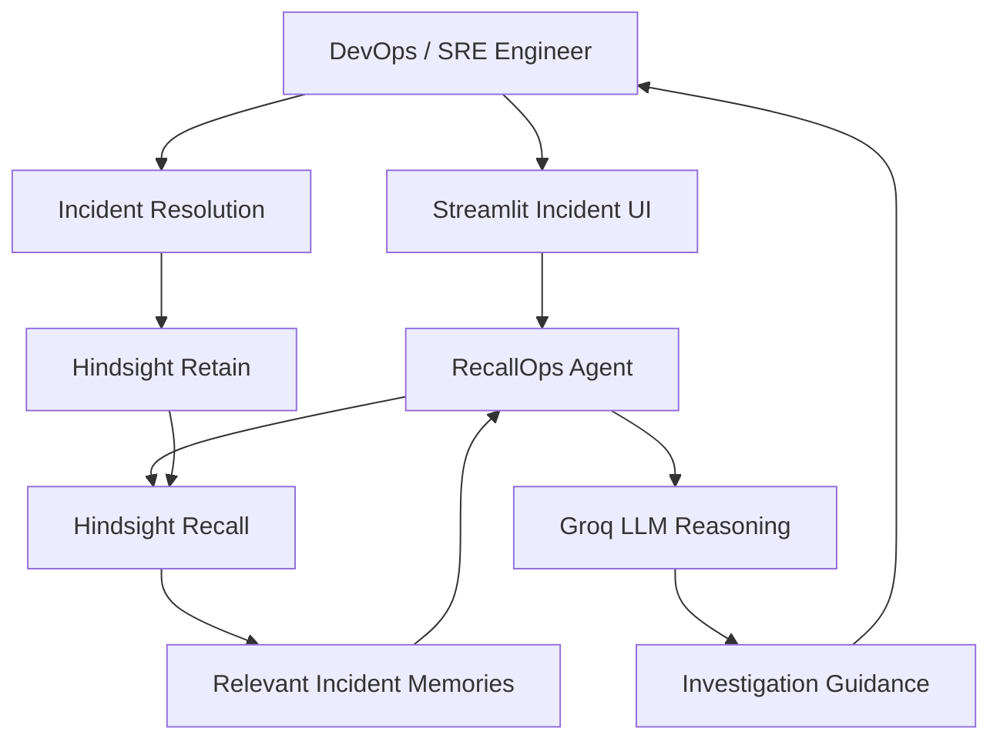

# RecallOps Architecture



## Memory loop

```text
Current incident
      ↓
Hindsight recall
      ↓
Prior operational experience
      ↓
LLM reasoning
      ↓
Targeted guidance
      ↓
Human validates and resolves
      ↓
Resolution outcome
      ↓
Hindsight retain
      ↓
Future incident recall
```
